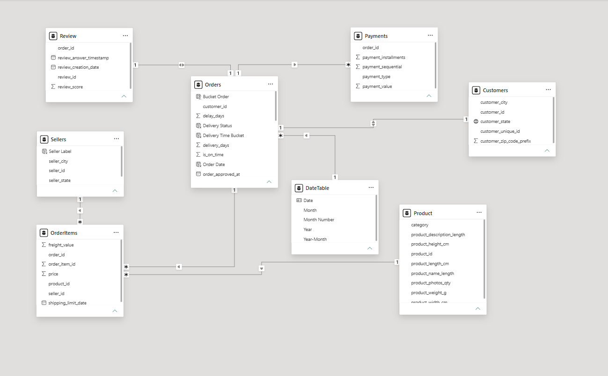
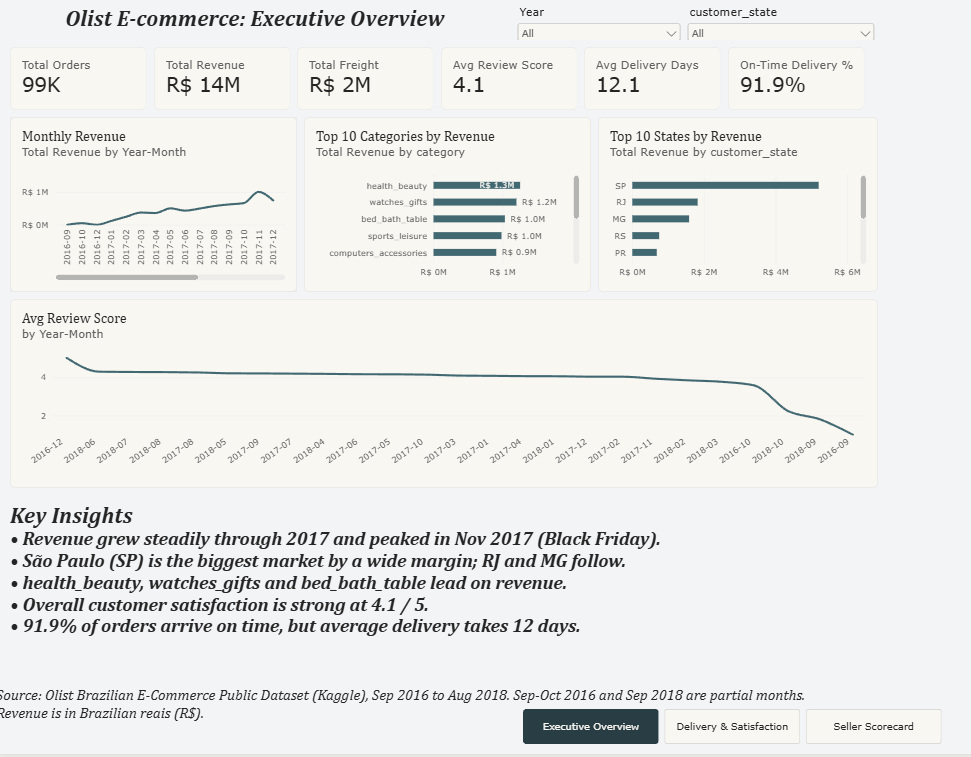
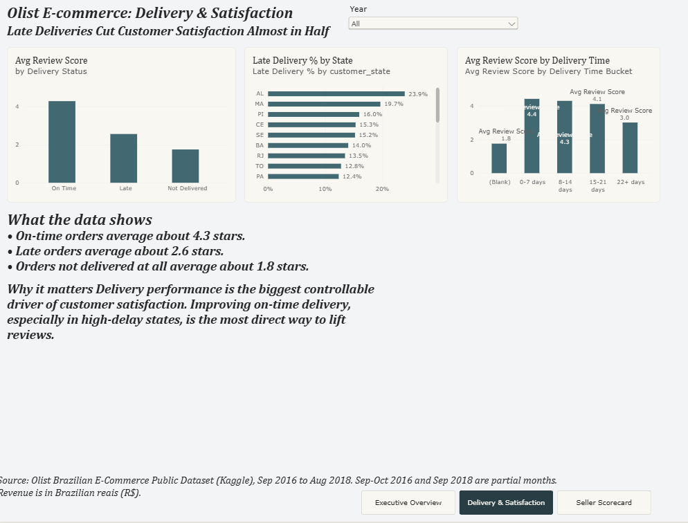
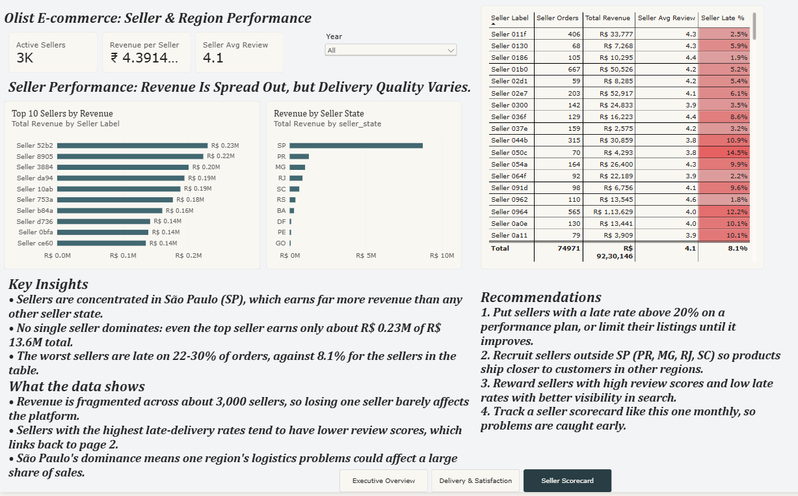

# Olist E-Commerce Analysis: Power BI Dashboard

An end-to-end Business Intelligence project built in **Power BI** on the Brazilian Olist e-commerce dataset. It covers data cleaning, data modeling, DAX measures and a 3-page interactive dashboard that answers one central question:

> **How does delivery performance affect customer satisfaction, and which sellers and regions drive (or hurt) the business?**

---

## Table of Contents

1. [Project Overview](#project-overview)
2. [Business Questions](#business-questions)
3. [Dataset](#dataset)
4. [Tools and Skills](#tools-and-skills)
5. [Data Preparation (Power Query)](#data-preparation-power-query)
6. [Data Model](#data-model)
7. [DAX Measures](#dax-measures)
8. [Dashboard Pages](#dashboard-pages)
9. [Key Findings](#key-findings)
10. [Recommendations](#recommendations)
11. [Limitations](#limitations)
12. [How to Open This Project](#how-to-open-this-project)
13. [Repository Structure](#repository-structure)
14. [Author](#author)

---

## Project Overview

Olist is a Brazilian marketplace that connects small sellers to customers. This project analyzes about **99,000 orders** placed between **September 2016 and August 2018** across 8 related tables.

The dashboard has three pages:

| Page | Purpose |
|---|---|
| **Executive Overview** | High-level KPIs, revenue trend, top categories and states |
| **Delivery & Satisfaction** | How delivery speed and lateness affect review scores |
| **Seller Scorecard** | Seller revenue, geographic concentration and late-delivery performance |

---

## Business Questions

1. How large is the business, and how has revenue changed over time?
2. Which product categories and states generate the most revenue?
3. Do late deliveries hurt customer reviews, and by how much?
4. Which states have the worst delivery performance?
5. How concentrated is revenue among sellers, and which sellers have the highest late-delivery rates?

---

## Dataset

- **Source:** [Brazilian E-Commerce Public Dataset by Olist (Kaggle)](https://www.kaggle.com/datasets/olistbr/brazilian-ecommerce)
- **Period:** September 2016 to August 2018
- **Size:** about 99K orders, about 3,000 sellers
- **Currency:** Brazilian reais (R$)

| Table | Description |
|---|---|
| `Orders` | One row per order, with status and timestamps |
| `OrderItems` | Products in each order, with price and freight |
| `Customers` | Customer city and state |
| `Sellers` | Seller city and state |
| `Product` | Product details and category (translated to English) |
| `Payments` | Payment type and value |
| `Review` | Customer review score per order |
| `DateTable` | Calendar table created in DAX |

The raw CSV files are in the [`data/`](data/) folder.

---

## Tools and Skills

- **Power BI Desktop**: report design, interactivity, slicers, navigation
- **Power Query (M)**: data cleaning and transformation
- **DAX**: calculated columns, measures, `CALCULATE`, `CROSSFILTER`, `SWITCH`, `DIVIDE`
- **Data modeling**: relationships, filter direction and a date table

---

## Data Preparation (Power Query)

| Step | What was done | Why |
|---|---|---|
| Load | Imported 9 CSV files and renamed them with clean table names | Readable DAX and visuals |
| Data types | Set date columns to Date/Time, price and freight to Fixed decimal number | Correct calculations |
| Reviews | Removed free-text comment columns and duplicate `order_id` rows | Keeps one review per order and a clean relationship |
| Products | Fixed misspelled column names, merged the English category translation, replaced missing categories with `unknown` | English labels and no blank categories |
| Duplicates | Removed duplicate rows on `product_id` | A relationship needs a unique key on the "one" side |
| Geolocation | Disabled load for this table | About 1M rows, not needed for the analysis |
| Orders | Added `delivery_days`, `delay_days` and `is_on_time` columns | Foundation for delivery analysis |
| Nulls | Kept blank delivery dates for undelivered orders | Removing them would distort the numbers |

---

## Data Model

The model is a star-style schema with **Orders** as the central hub.



| Relationship | Cardinality |
|---|---|
| Customers → Orders | One to many |
| Orders → OrderItems | One to many |
| Product → OrderItems | One to many |
| Sellers → OrderItems | One to many |
| Orders → Payments | One to many |
| Orders ↔ Review | One to one |
| DateTable → Orders (`Order Date`) | One to many |

---

## DAX Measures

### Core KPIs

```DAX
Total Orders = DISTINCTCOUNT(Orders[order_id])

Total Revenue = SUM(OrderItems[price])

Total Freight = SUM(OrderItems[freight_value])

Avg Review Score = AVERAGE(Review[review_score])

Avg Delivery Days = AVERAGE(Orders[delivery_days])

On-Time Delivery % =
DIVIDE(SUM(Orders[is_on_time]), COUNT(Orders[is_on_time]))

Late Delivery % =
DIVIDE(
    CALCULATE(COUNT(Orders[is_on_time]), Orders[is_on_time] = 0),
    COUNT(Orders[is_on_time])
)
```

### Seller measures (filters flow backwards using `CROSSFILTER`)

```DAX
Active Sellers = DISTINCTCOUNT(OrderItems[seller_id])

Seller Orders = DISTINCTCOUNT(OrderItems[order_id])

Revenue per Seller = DIVIDE([Total Revenue], [Active Sellers])

Seller Avg Review =
CALCULATE(
    AVERAGE(Review[review_score]),
    CROSSFILTER(OrderItems[order_id], Orders[order_id], BOTH)
)

Seller Late % =
CALCULATE(
    [Late Delivery %],
    CROSSFILTER(OrderItems[order_id], Orders[order_id], BOTH)
)
```

> **Why `CROSSFILTER`?** Filters normally flow from `Orders` down to `OrderItems`. When a visual is split by seller, review and delivery data on the Orders side would not be filtered. `CROSSFILTER(..., BOTH)` makes the relationship two-way for that one measure only, so the rest of the model stays unchanged.

### Calculated columns

```DAX
Delivery Status =
SWITCH(
    TRUE(),
    ISBLANK(Orders[is_on_time]), "Not Delivered",
    Orders[is_on_time] = 1, "On Time",
    "Late"
)

Delivery Time Bucket =
SWITCH(
    TRUE(),
    ISBLANK(Orders[delivery_days]), BLANK(),
    Orders[delivery_days] <= 7, "0-7 days",
    Orders[delivery_days] <= 14, "8-14 days",
    Orders[delivery_days] <= 21, "15-21 days",
    "22+ days"
)

Seller Label = "Seller " & RIGHT(Sellers[seller_id], 4)
```

---

## Dashboard Pages

### 1. Executive Overview



| KPI | Value |
|---|---|
| Total Orders | about 99K |
| Total Revenue | about R$ 13.6M |
| Total Freight | about R$ 2M |
| Avg Review Score | 4.1 / 5 |
| Avg Delivery Time | 12.1 days |
| On-Time Delivery | 91.9% |

### 2. Delivery & Satisfaction



### 3. Seller Scorecard



**Interactivity:** a synced **Year** slicer, a **state** slicer on page 1, cross-filtering between visuals, and a page navigator on every page.

---

## Key Findings

1. **Revenue grew through 2017 and peaked in November 2017**, consistent with Black Friday sales.
2. **São Paulo (SP) is the dominant market**, with RJ and MG behind it. Sellers are also heavily concentrated in SP.
3. **Late delivery hurts satisfaction.** On-time orders average about **4.3 stars**, late orders about **2.6**, and orders that were never delivered about **1.8**. A late delivery lowers the average review by roughly 40%.
4. **Reviews hold up to about 3 weeks, then drop.** Orders delivered within 21 days average 4.1 to 4.4 stars, but orders taking **22+ days fall to about 3.0**.
5. **Delivery problems are regional.** The highest late-delivery rates are in northeastern states: **AL (23.9%), MA (19.7%), PI (16.0%), CE (15.3%) and SE (15.2%)**.
6. **Revenue is spread across many sellers.** The top seller earns only about R$ 0.23M of R$ 13.6M total, so the platform does not depend on any single seller.
7. **A small group of sellers has serious delivery problems.** Some sellers are late on more than 20% of orders, against about 8% for the platform overall.

---

## Recommendations

1. **Put high-late-rate sellers on a performance plan.** Sellers above 20% late should improve or have their listings limited.
2. **Fix logistics in the northeast.** Add regional warehouses or better carrier partnerships for AL, MA, PI, CE and SE.
3. **Set a delivery-time target of 21 days or less.** Customer satisfaction drops sharply after that point.
4. **Recruit sellers outside São Paulo** (PR, MG, RJ, SC) so goods ship closer to customers.
5. **Reward high performers.** Give better search visibility to sellers with strong reviews and low late rates.
6. **Monitor a seller scorecard monthly** to catch problems early.

---

## Limitations

- **Partial months:** September to October 2016 and September 2018 contain very few orders, so trends at the start and end of the timeline are not reliable.
- **Small samples:** the average review in months with very few orders can swing sharply. The seller scorecard only includes sellers with at least 50 orders.
- **Late delivery is measured against the estimated date** provided in the data, not against a fixed number of days.
- **Not delivered orders** (cancelled or unavailable) are counted separately and excluded from on-time and late percentages.
- **Correlation, not proof of causation:** late deliveries are linked to lower reviews, but other factors such as product quality may also play a part.

---

## How to Open This Project

1. Install [Power BI Desktop](https://www.microsoft.com/power-platform/products/power-bi/desktop) (free, Windows only).
2. Clone or download this repository.
3. Open `dashboard/olist_dashboard.pbix`.
4. If Power BI asks for the data location, go to **Home → Transform data → Data source settings** and point each file to the `data/` folder.

---

## Repository Structure

```
olist-ecommerce-analysis-powerbi/
├── README.md
├── data/               # raw Olist CSV files
├── dashboard/          # olist_dashboard.pbix
└── screenshots/        # dashboard and data model images
```

---

## Author

**Your Name**
[GitHub](https://github.com/TanishqVarpe) · [LinkedIn](https://www.linkedin.com/in/tanishq-varpe/)

*Built as part of a Business Intelligence course mini-project series.*
